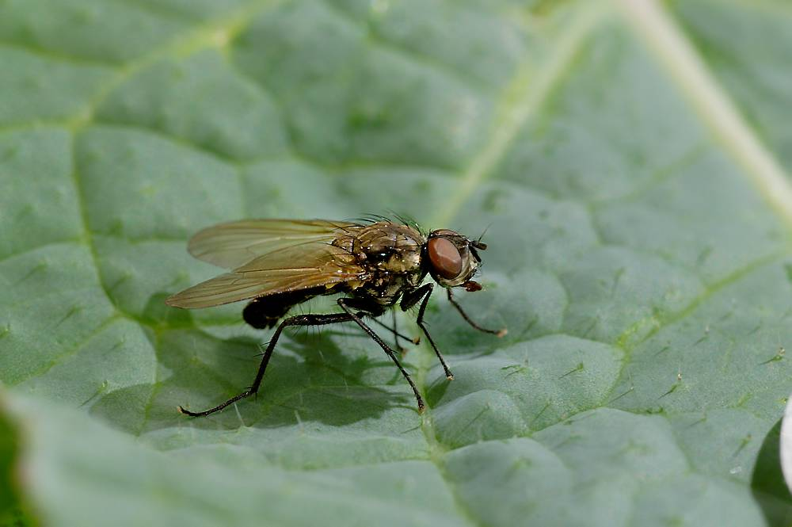

# DeliaRadicumModel
&copy; [NIBIO](https://nibio.no/en)



<p>The model determines the flight period. It gives information about the expected time of the first oviposition and continued oviposition of the cabbage maggot in cruciferous crops. The model only applies for cabbage maggot, not turnip fly.</p>
<p>The basis data for the warning system are from studies on adult hatching and oviposition period for cabbage maggot in the project Norgesprosjektet (LR, 1999-2001), Nye metoder for bekjempelse av k&aring;lfluer (forskerprosjekt, NFR, 2004-2007) and a user supported project from Norges Gartnerforbund (2005-2007). These results are published in Johansen &amp; Meadow (2002, 2005, 2006), Johansen (2007) og Meadow <em>et al. </em>(2008). The cabbage maggot begins to lay eggs 5-7 days after hatching (eclosure). The data indicate that the start of oviposition on average is at about 160 degree-days (day-degrees) based on soil temperature (10 cm) (day-degrees &gt; 4 &deg;C). Based on the standard air temperature (2 m above the soil surface) at the same locations, the start of oviposition was registered when the average cumulative temperature exceeded 210 degree days. These results are supported by observations in Great Britain (Collier &amp; Finch, 1985, 179 and 230 degree-days for 50% Hatching, for soil and air temperature). Our calculations had somewhat large variation, thus the warning is only advisory. This warning model should be used together with observations in the field to register the severity of attack.</p>
<p>Historical weather data and weather forecasts (2 days) are used in the model. <br /> The measured parameters that are input in the model are hourly standard air temperature (TM) or soil temperature (TMJ 10). Soil temperature is used when available. Calculated parameters: Mean daily temperature using 4 &deg;C as the base temperature (i.e. mean daily temperature minus 4 &deg;C). 4 &deg;C is a theoretically calculated minimum temperature for post-diapause development.</p>
<p>The model has been developed by Dr. Tor J. Johansen, NIBIO.</p>
<h3>Interpretation of the warning</h3>
<p>The warning can be calculated based on either soil temperature or air temperature. When the weather station records soil temperature in addition to air temperature, soil temperature is used for the warning that is presented on the map page and in the table under the graph. The graph shows both the soil temperature and air temperature together with day-degree calculations and the associated threshold values.</p>
<p>Green rectangles indicate that the flight period has not yet begun. The accumulated day-degrees are below the threshold. Green rectangles are only shown prior to the start of oviposition.</p>
<p>Yellow rectangles indicate that the first oviposition will be soon. The farmer should make observations in the field. Yellow rectangles are first shown when the soil temperature has reached 140 day-degrees or the air temperature has reached 185 day-degrees. This correlates to approx. two normal spring days before the expected start of oviposition.</p>
<p>Red rectangles indicate that the start of oviposition is likely. The required accumulated day-degrees have been reached: 160 day-degrees (soil temperature) or 210 day-degrees (air temperature).</p>
<p>The graphic presentation shows the progress of the day-degree calculation that is the basis for the green, yellow and red warnings (the lines: &laquo;Day-degrees (air) base temperature 4 degrees Celsius&raquo; and &laquo;Day-degrees (soil, 10 cm depth), base temperature 4 degrees Celsius&raquo;). The graph shows straight horizontal lines for the threshold values. There is a set of threshold values for soil temperature (for the weather stations where this is recorded) and a set of threshold values for air temperature.</p>
<p>Soil temperature <br /> &laquo;Lower threshold for accumulated soil temperature&raquo; corresponds to the threshold where the warning changes from green to yellow based on soil temperature (140 day-degrees). &laquo;Upper threshold for accumulated soil temperature&raquo; corresponds to the threshold where the warning changes from yellow to red based on soil temperature (160 day-degrees). When the line &laquo;Mean temperature in soil, 10 cm depth, base temperature 4 degrees Celsius&raquo; crosses one of the lines for accumulated soil temperature, the warning will reach the next level and the color of the warning rectangle on the map page in VIPS will change.</p>
<p>Air temperature (used when soil temperature is not available)</p>
<p>&laquo;Lower threshold for accumulated air temperature&raquo; corresponds to the threshold where the warning changes from green to yellow based on air temperature (185 day-degrees). &laquo;Upper threshold for accumulated air temperature&raquo; corresponds to the threshold where the warning changes from yellow to red based on air temperature (210 day-degrees). When the line &laquo;Day-degrees base temperature 4 degrees Celsius&raquo; crosses one of the lines for accumulated air temperature, the warning will reach the next level and the color of the warning rectangle on the map page in VIPS will change.</p>
<p>Be aware that in areas with field covers (plastic, single or double non-woven covers, etc.) with early crops the preceding season (either on the current field or neighboring fields), the flight period can start earlier due to higher soil temperature under the covers.</p>
<p>This model should be used in combination with direct observations of eggs in the field. This is due to large variability and to get an idea of the severity of attack.</p>
<p>In Northern-Norway the turnip fly will usually begin oviposition 10-14 days after the cabbage maggot. There is no such relationship between the two species in Southern-Norway.</p>
<h3>&laquo;Warning season &ndash; start and end of the warning&raquo;</h3>
<p>Starting time: When the soil temperature exceeds 0 &deg;C, at the latest when the mean daily temperature in the soil (10cm) (TMJ 10) is above 4 &deg;C. In effect, the model is started 1 March (when the soil has thawed and without snow cover after 1 March).</p>
<p>Ending time: 1 July south of and including Tr&oslash;ndelag, 15 July north of Tr&oslash;ndelag.</p>
<h3>Testing and validation of the model</h3>
<h4>Nationally</h4>
<p>The model has not been validated since it was put into use in VIPS in 2008, but the background for the model is Norwegian data for time of eclosure and oviposition in different locations in Norway.</p>
<h4>Internationally</h4>
<p>International testing and validation of this model is not relevant as the model is based on Norwegian data. However, information is available about time of eclosure from other countries (Collier &amp; Finch, 1985) and similar day-degree models have been made and are used internationally.</p>
<h3>References</h3>
<p>Johansen, T.J. &amp; R. Meadow 2002. Bekjempelse av k&aring;lfluene - fra teori til praksis. Gr&oslash;nn forskning 2/2002: 117-122.</p>
<p>Johansen, T.J. &amp; R. Meadow 2005. Emergence patterns of Norwegian brassica root fly populations. IOBC/WPRS Bulletin 28 (4): 25-29.</p>
<p>Johansen TJ og R. Meadow 2006. Population differences in emergence of brassica root flies (Diptera: Anthomyiidae). Environmental Entomology 35: 1161-1165.</p>
<p>Johansen, T.J. 2007. K&aring;lfluene &ndash; biologi og mulige tiltak. Bioforsk Fokus 2 (13): 33-35.</p>
<p>Meadow, R., T.J. Johansen, R. Selj&aring;sen og S. Haukeland 2008. Hva n&aring; lille flue? Oppsummering fra k&aring;lflueprosjekter. Bioforsk Fokus 3 (1): 10-12.</p>
<p>Collier, R. and S. Finch 1985. Accumulated temperatures for predicting the time of emergence in the spring of the cabbage fly, Delia radicum (L.) (Diptera: Anthomyiidae)</p>
<p>Tiilikkala, K. and H. Ojanen 1999. Use of geographical information system (GIS) for forecasting the activities of carrot fly and cabbage root fly. IOBC/WPRS Bulletin 22 (5): 15-24.</p>
<p>Contacts: Tor J. Johansen (<a href="mailto:tor.johansen@nibio.no">tor.johansen@nibio.no</a>) / Annette F. Schj&oslash;ll (annette.folkedal.schjoll@nibio.no)</p>
<h3>Links for more information</h3>
<p>Norwegian only: <a href="https://www.plantevernleksikonet.no/l/oppslag/1483/" target="new">https://www.plantevernleksikonet.no/l/oppslag/1483/</a></p>

## Development

Clone Gitlab repository

```
$ git clone https://gitlab.nibio.no/VIPS/models/java/Model_DELIARADIC.git
$ cd Model_DELIARADIC
```

### Compile, run tests
```bash
mvn clean install
```

### Deploy to VIPSCore
See [the VIPSCore README](https://gitlab.nibio.no/VIPS/VIPSCore)